<p align="center">    </p>

<p align="center">
  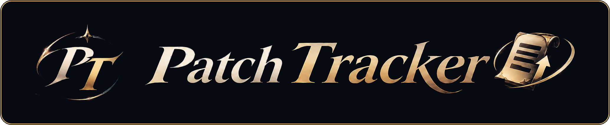
</p>

<h3 align="center">A personalised patch report for League of Legends players</h3>
<p align="center">
  Shows how the newest game update affected your most used champions and items.
  <br>
  <sub><i>This is the current working version. New features are still being added.</i></sub>
</p>

<p align="center">
  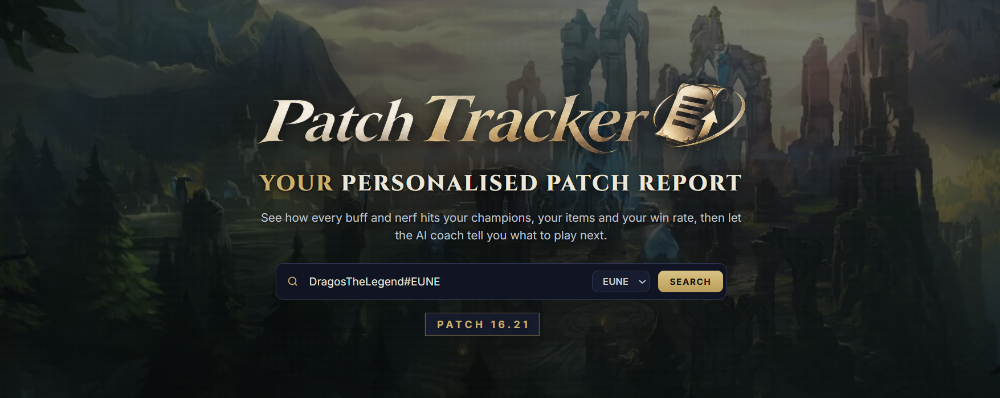
</p>

<p align="center">
  <a href="#why-i-built-it"></a>
  <a href="#what-it-does"></a>
  <a href="#screenshots"></a>
  <a href="#how-it-works"></a>
  <br>
  <a href="#development-process"></a>
  <a href="#to-do"></a>
  <a href="#run-it-locally"></a>
</p>

## Why I built it

Every new patch comes with a long list of changes. Finding the ones that affected my champions and items took too long, so I often skipped the patch notes and went into games without knowing what had changed. My playstyle felt weaker than before, even though my decisions and mechanics were mostly the same. I often did not know that my champions or items had been nerfed, and this affected my games.

So I built the tool I wanted: an automatic web app that shows me exactly the changes that are relevant to my own playstyle, based on the champions I play and the items I build.

<table>
<tr>
<td width="60%">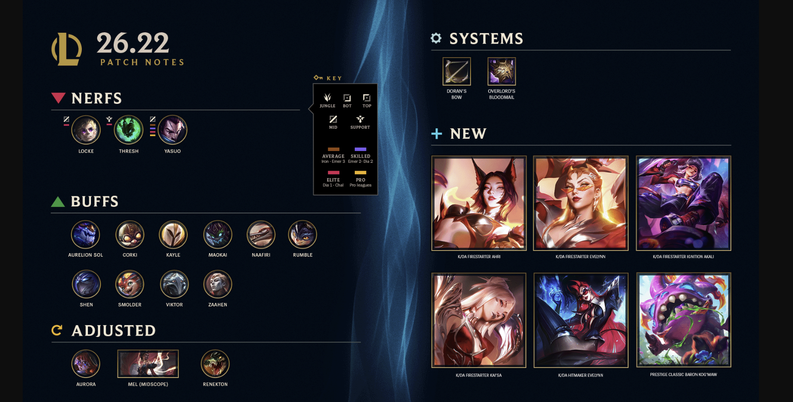</td>
<td width="40%">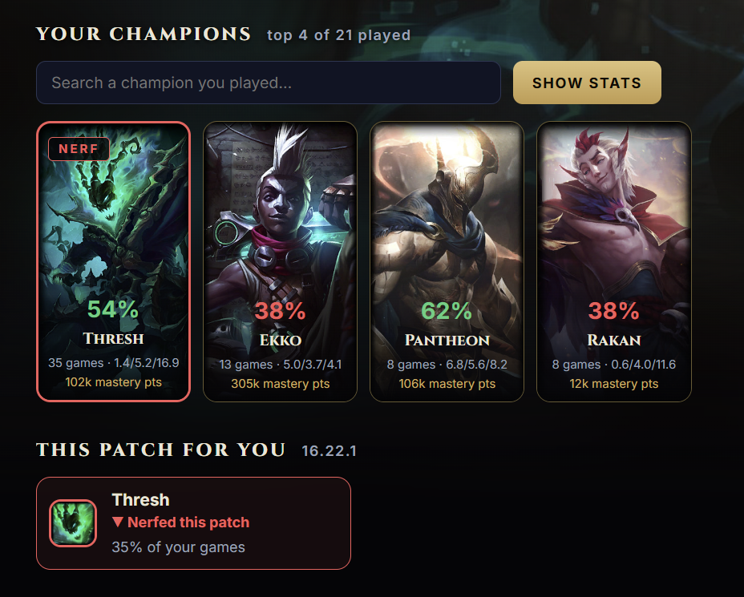</td>
</tr>
<tr>
<td align="center"><sub>Official patch notes: every change for every player</sub></td>
<td align="center"><sub>PatchTracker: only the changes to your champions</sub></td>
</tr>
</table>

## What it does

### Personal patch report
Loads your recent games and marks which of your champions and most built items were buffed or nerfed.

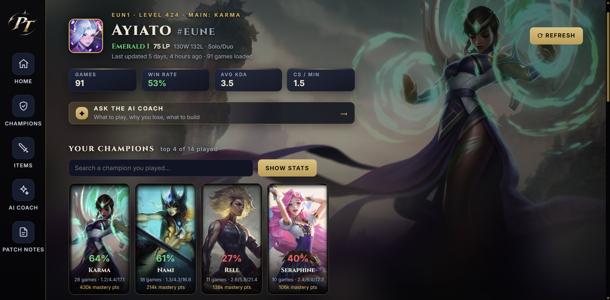

### Patch advice
When something you play gets nerfed, it suggests what to do, based on your own win rates: play a different champion, change how you play, or replace a nerfed item with a similar one.

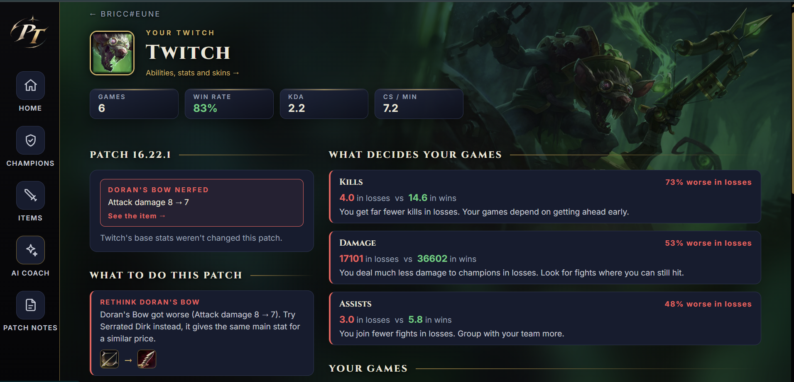

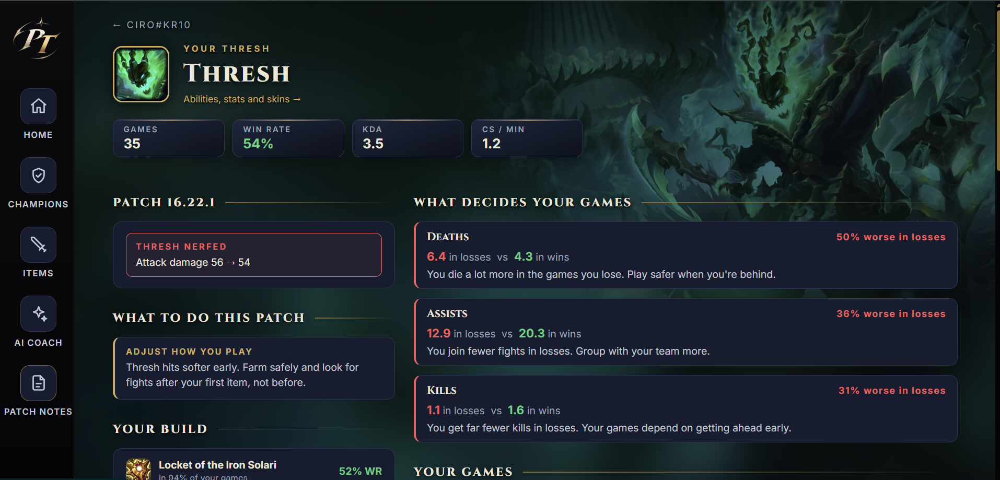

### Player stats per champion
Win rate, KDA and CS per champion, your builds with a win rate per item, and the stats that differ most between your wins and your losses.

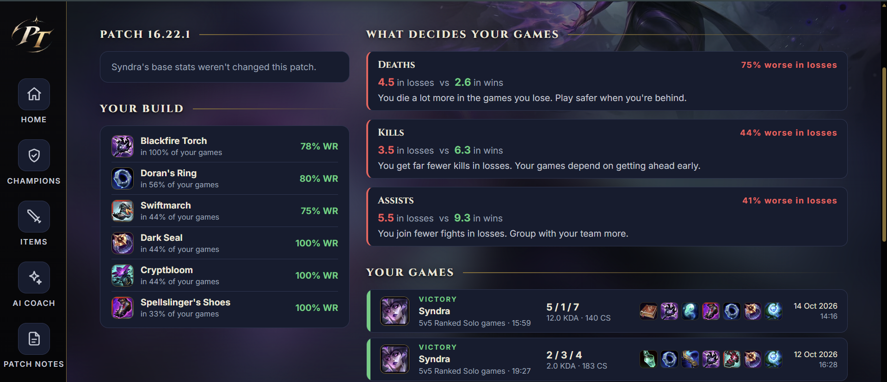

### AI coach
A chat that answers questions such as "What should I play this patch?" using your own match data.

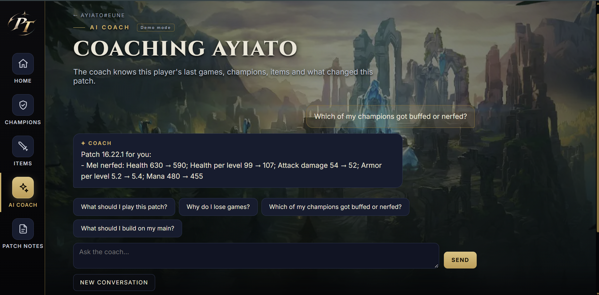

### Game data
Champion and item pages for the current patch, and patch notes between any two loaded patches. The champion detail and skins pages are in [Screenshots](#screenshots).

**Champions:** every champion, with class filters and BUFF / NERF tags.

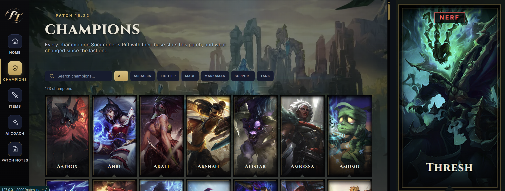

<br>

**Items:** every item on Summoner's Rift, with its price, stats and the change since the last patch.

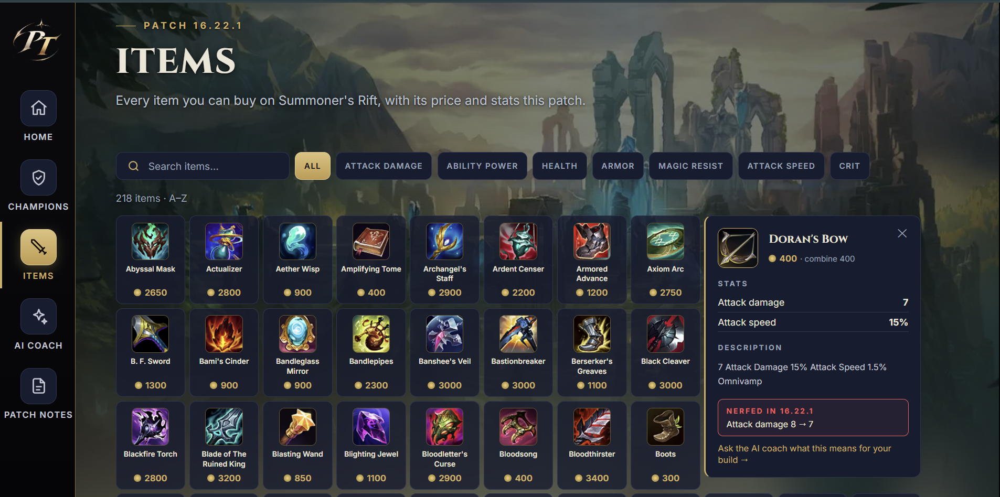

<br>

**Patch notes:** every champion and item change between two loaded patches.

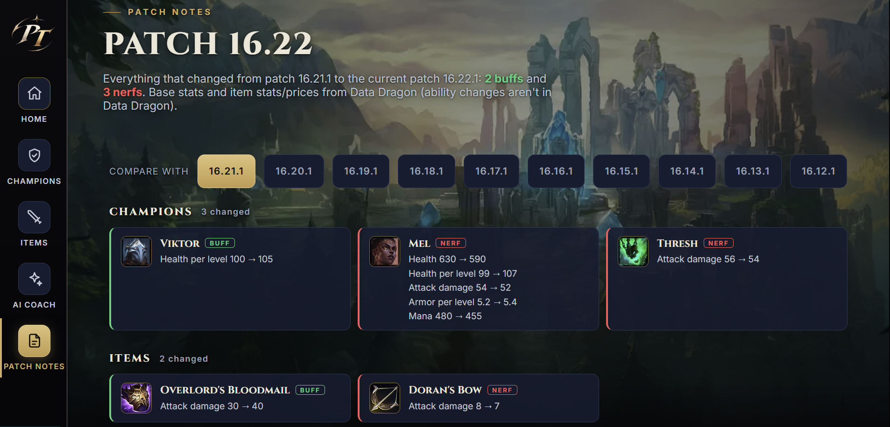

## Screenshots

**Champion page:** abilities with cooldown, cost and range, and the lore from Data Dragon.

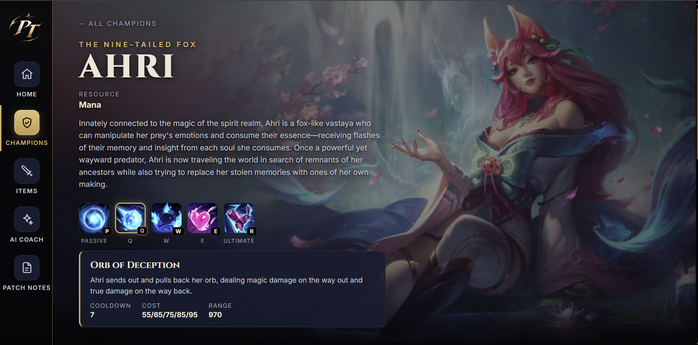

**Skins:** every skin of the champion. Click a skin to change the background art.

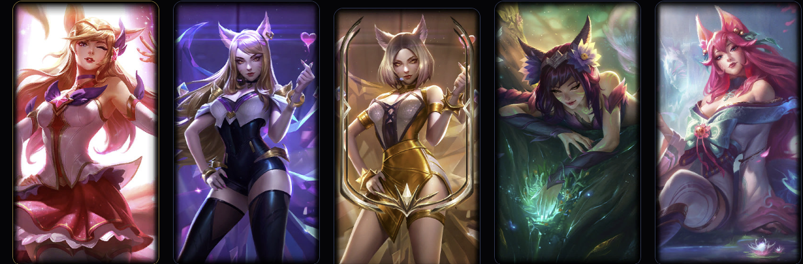

## How it works

Two commands load the data into PostgreSQL: `load_ddragon` loads the game data from Data Dragon, and `load_player` loads a player and their games from the Riot API. Django then queries the database and shows the results on the web pages. The AI coach sends a summary of the player's data to the Claude API.

**Data loading**
- `load_ddragon` reads 10 patches from Data Dragon (Riot's static game data): champions, abilities, skins, and the stats of every champion and item *per patch*.
- `load_player` uses five Riot API endpoints (account, match, summoner, league, mastery). It only downloads matches that are not stored yet, and it handles rate limits with retries and the `Retry-After` header.

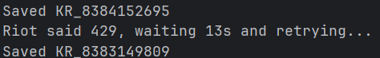

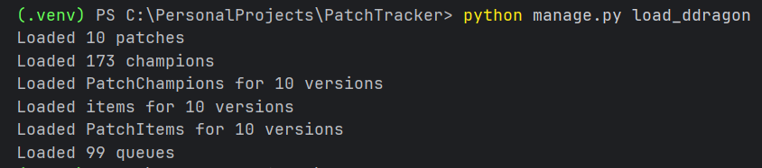

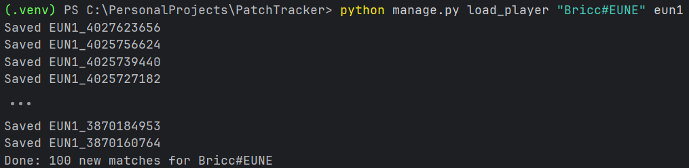

**Detecting buffs and nerfs**
- Stats are stored per patch, so two patches can be compared row by row.
- Every changed stat adds its percentage change to a score. A positive score is a buff, a negative score is a nerf. For items, a higher price counts as a nerf.
- The changes are then matched against the champions the player plays and the items they build most on each champion.
- **Limit:** Data Dragon gives base stats per patch, but not the numbers of abilities and passives (damage, cooldowns, scaling). So a champion that got only ability changes does not show as buffed or nerfed, and the official patch notes list more changed champions than PatchTracker.
- **Patch names:** Data Dragon uses its own version numbers (for example 16.21.1). Riot's public patch notes name the same patch by the year (26.21). PatchTracker shows the Data Dragon number.

Example: the official notes for patch 26.22 list a Viktor health growth buff from 100 to 105 per level. PatchTracker finds the same change in the Data Dragon data for 16.22.1 (see the Patch Notes page above).

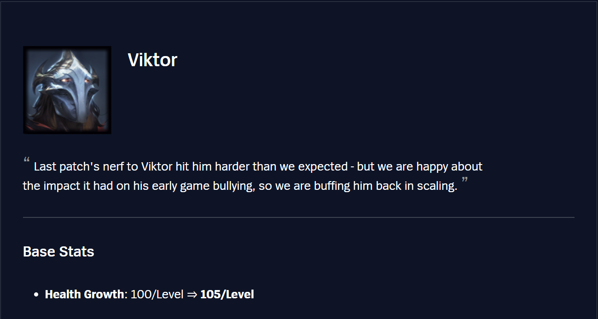

Viktor's rows in `PatchChampion` for two patches. Only `hp_per_level` changed (100 → 105), so Viktor is marked as buffed:

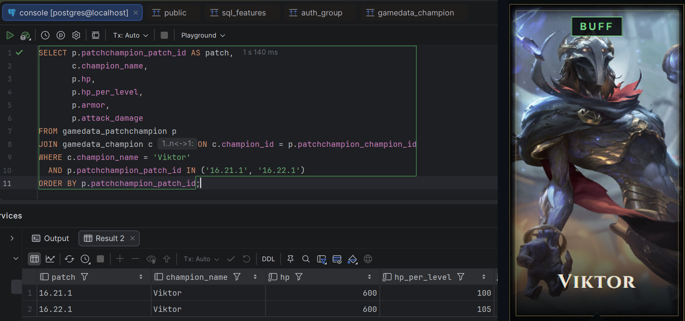

The same change on Viktor's champion page:

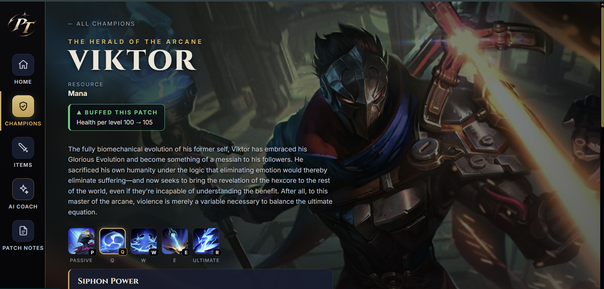

**Patch advice**
- Rule-based, from the player's own data. Example: a nerfed champion with a win rate under 48% leads to a suggestion of the player's best champion that was not nerfed.
- A nerfed item is matched with an item that gives the same main stat for a similar price, preferring items the player already won with.

**AI coach**
- No model is trained. Each question sends Claude a summary of the player built from database queries (champions, roles, items, recent games, patch changes), so the answers are about that player.
- **The public version runs without a Claude API key**, because every request to the Claude API costs real money. The full integration is in the code: add a key to `.env` and the coach uses Claude. Without a key, a rule-based demo mode answers with the same player data.

**Database design**

Two Django apps: `gamedata` (game data per patch) and `matches` (players and their games).

**`gamedata` tables (game data from Data Dragon):**
- `Patch`: one row per game version, for example 16.22.1.
- `Champion`: one row per champion, with its name, title, lore and class (`Tag`, many-to-many).
- `PatchChampion`: the base stats of one champion in one patch. Two patches can be compared row by row.
- `Item` and `PatchItem`: the same idea for items, with the price and stats of each item in each patch.
- `Ability` and `Skin`: the abilities and skins of each champion.

**`matches` tables (players and their games from the Riot API):**
- `Player`: one row per player, keyed by Riot's `puuid`.
- `Match`: one row per game, with the patch it was played on and its `Queue` (game mode).
- `MatchPlayer`: one player's result in one game: champion, role, win or loss, kills, deaths, assists, CS, gold and damage.
- `MatchPlayerItem`: the items that the player had at the end of the game, one row per item slot.

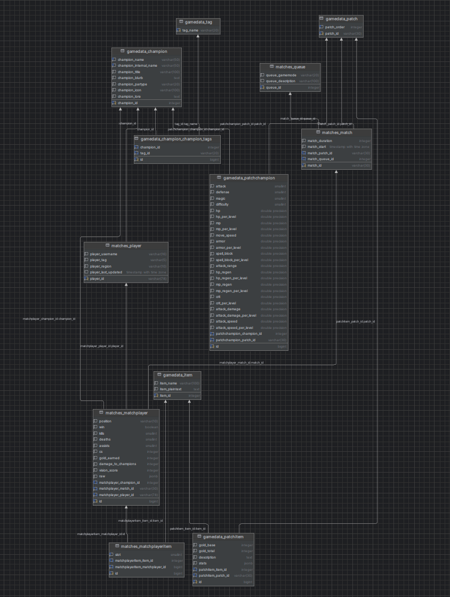

**Normalization:** I designed the schema to follow the rules of database normalization, up to third normal form (3NF). Each table holds one kind of data, each column depends only on the key of its table, and data that would repeat is in its own table (for example `Tag`, `Queue`, and the per-patch stats in `PatchChampion` and `PatchItem`).

**Design decisions:**
- **Stats are stored per patch** (`PatchChampion`, `PatchItem`). Old values are never overwritten, so any two patches can be compared.
- **Players are keyed by Riot's `puuid`.** A Riot ID (name and tag) can change, but the `puuid` cannot.
- **The game mode is in a separate `Queue` table.** The game mode depends on the queue, not on the match (third normal form).
- **The full Riot data is kept in a `JSONField`.** Riot sends more than 140 fields per player per game. The 10 or so fields that the site uses are normal columns, and the rest stays in JSON.
- **Unique constraints** on (patch, champion), (patch, item), (match, player) and (match player, slot) let the loaders run again without duplicate rows.
- **`select_related`, `prefetch_related`, `aggregate()` and `annotate()`** keep each page at a fixed number of queries (no N+1), and PostgreSQL calculates the statistics.
- **Remakes are excluded with one queryset method (`counted()`).** Games that ended in an early surrender do not change the win rates, but they still show in the match history.

## Development process

I followed an iterative, Agile-style software development life cycle. I split the work into one-week iterations (sprints), each with a clear goal and a working result: game data, then match data, then the web pages, then the advice and the AI coach. In each iteration I planned the features, built them, tested them with real players' data and reviewed the result before the next step. The page designs went through many quick versions based on feedback.

**1. Early sketches.** Before writing code, I drew my first ideas on paper. This early sketch does not match the final project, because the scope changed a lot (for example, emotes, wards and chromas were removed). It shows how the planning started. Even at this step I applied database normalization: the region and the server got their own tables with one-to-many relations, so that the same data is not repeated on every player row.

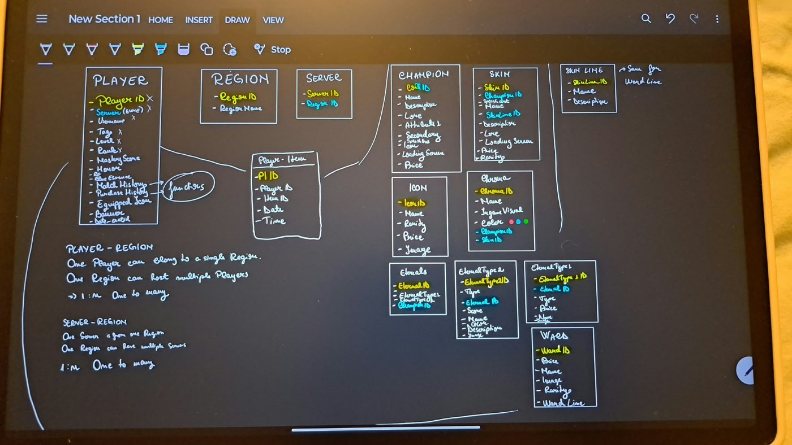

**2. First schema in Azure SQL.** The first version was a Python script that loaded Data Dragon JSON into Azure SQL. It showed the first data problems early, for example duplicate champion entries in older patches that the loader must skip.

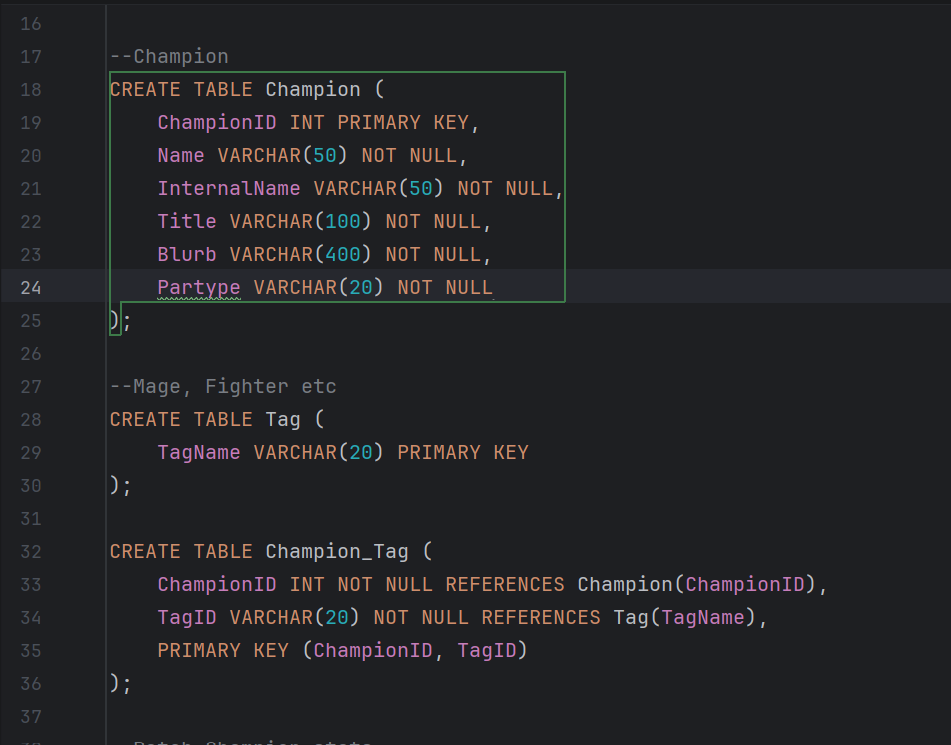

Part of the first loader script, which wrote the patches into Azure SQL with plain SQL and `executemany`:

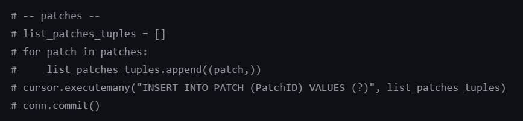

**3. Django and PostgreSQL.** I moved to Django models and migrations, so the whole schema lives in code and can be rebuilt on any machine.

**4. Match data, then the web pages.** I added players and matches from the Riot API, then built the pages and tested many designs before choosing a dark theme with gold accents.

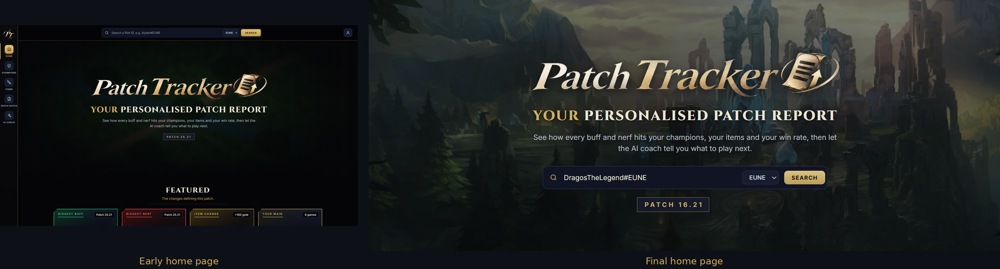

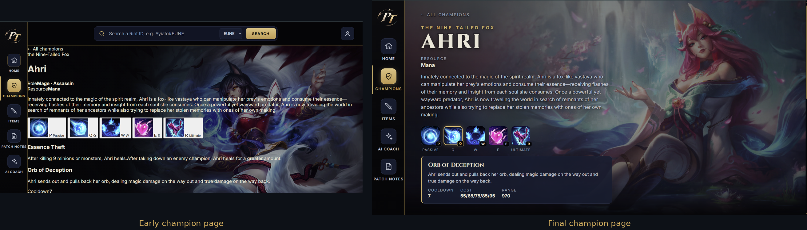


**5. Advice and AI coach.** Last, I added the patch advice and the Claude API coach on top of the same queries.

## To do

What I plan to add next:

- [ ] **Apply for a personal Riot API key**: the development key stops working every 24 hours. A personal key lets the site load players at any time.
- [ ] **Automated tests**: unit tests for the buff/nerf scoring and the loaders, run automatically on every push with GitHub Actions.
- [ ] **Live demo link**, so the site can be opened in a browser without installing anything.
- [ ] **Mobile and tablet layout**, so the site works on any device.
- [ ] **Automatic patch updates**: a scheduled job that runs `load_ddragon` and loads a new patch as soon as it comes out.

Bigger ideas for later:

- **Meta recommendations.** Suggest strong champions for the current patch from the changes and from many players' results, not only your own.
- **Teamfight and play analysis.** Riot's match timeline endpoint gives kills, items and positions per minute. With it, the coach could explain where a fight went wrong or when your power spikes are.

## Run it locally

**Requirements:** Python 3.12+, PostgreSQL and a Riot API key ([developer.riotgames.com](https://developer.riotgames.com)). A Claude API key is optional.

```bash
git clone <this repo>
cd PatchTracker
python -m venv .venv
.venv\Scripts\activate          # Windows (macOS/Linux: source .venv/bin/activate)
pip install -r requirements.txt
```

Create a `.env` file in the project folder. Git ignores it, so keys are never committed.

```
RIOT_API_KEY=your-riot-key
ANTHROPIC_API_KEY=your-claude-key   # optional, paid: without it the coach runs in demo mode
# plus your PostgreSQL settings and the Django SECRET_KEY
```

```bash
python manage.py migrate
python manage.py load_ddragon
python manage.py runserver
```

Open http://127.0.0.1:8000 and search a Riot ID, for example `Name#EUW`.

**Patch updates:** new patches are not loaded automatically yet. If the site does not show the newest patch, stop the server and run this command in the terminal:

```bash
python manage.py load_ddragon
```

The command loads only the patches that are missing, then you can start the server again.

---

<sub>I used AI tools (Claude) for help with parts of the front end and boilerplate. The database design, models, loaders and queries are my own work.</sub>

<sub>PatchTracker isn't endorsed by Riot Games and doesn't reflect the views or opinions of Riot Games or anyone officially involved in producing or managing Riot Games properties. Riot Games, and all associated properties are trademarks or registered trademarks of Riot Games, Inc.</sub>
